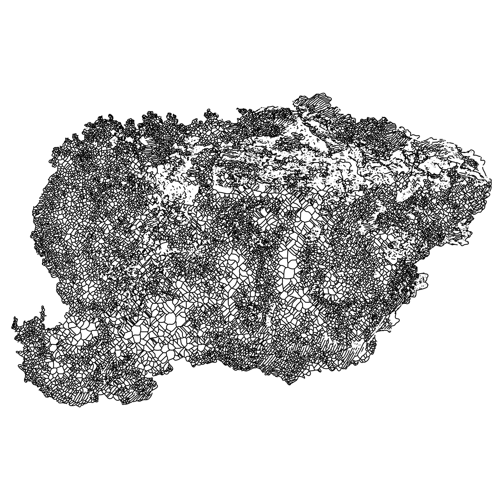

    

<a href="Figure-004.md">←</a> |
<a href="Figure-004.md">01</a> | 
<a href="Figure-005.md">02</a> | 
<a href="Figure-006.md">03</a> | 
<a href="Figure-007.md">04</a> | 
<u>05</u> | 
<a href="Figure-004.md"><svg xmlns="http://www.w3.org/2000/svg" width="14" height="13" fill="currentColor" class="bi bi-chevron-right" viewBox="0 0 16 16"><path fill-rule="evenodd" d="M4.646 1.646a.5.5 0 0 1 .708 0l6 6a.5.5 0 0 1 0 .708l-6 6a.5.5 0 0 1-.708-.708L10.293 8 4.646 2.354a.5.5 0 0 1 0-.708"/></svg></a>

